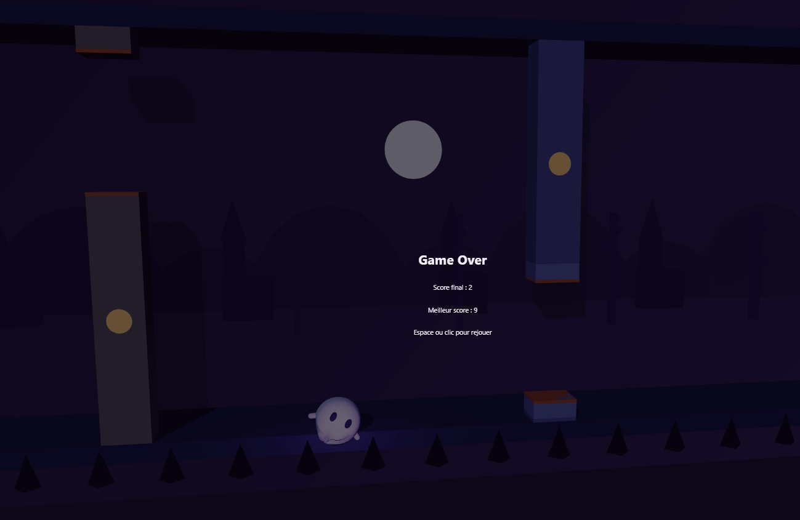

# Flappy Kiro

Un Flappy Bird en 2.5D à l'ambiance Halloween. Kiro, un petit fantôme, se faufile entre des stèles et des arbres morts dans un cimetière sous la lune. Les obstacles arrivent au rythme de la musique : à chaque mesure, un nouveau passage s'ouvre.



## Fonctionnalités

- Rendu 3D léger (Three.js) vu en 2.5D : caméra légèrement inclinée, ombres, brouillard, lune et décor en parallaxe sur plusieurs couches.
- Kiro est un fantôme en volume : bas ondulant, yeux ovales, bras qui se lèvent au battement, dissipation à la mort. Le mouvement réduit du système (`prefers-reduced-motion`) est respecté.
- Obstacles instanciés dans un pool fixe : stèles et arbres morts, en alternance.
- Audio synchronisé (Tone.js) : musique en couches (batterie, basse, nappe, mélodie, cloche), effet de battement et notes de score sur une gamme de ré mineur. Le tempo est de 120 BPM.
- Les obstacles apparaissent sur le temps musical, et la vitesse de défilement est dérivée du BPM. Sans audio, le jeu repasse en apparition par distance.
- Interface en français : écran titre, score, pause, Game Over, meilleur score, bouton de mute.
- Pause automatique quand l'onglet est masqué ou que la fenêtre perd le focus.
- Parties reproductibles grâce à un générateur aléatoire à graine.

## Lancer

```bash
npm install
npm run dev        # serveur de développement
npm run build      # typecheck + build de production
npm test           # tests (Vitest + fast-check)
npx eslint .       # lint
```

Le son démarre au premier geste (clic ou touche), comme l'exigent les navigateurs.

## Commandes

| Action | Entrée |
| --- | --- |
| Battre des ailes | Espace, flèche haut ou clic |
| Pause | P |
| Couper le son | M ou bouton à l'écran |

Le meilleur score est conservé dans le `localStorage`.

## Paramètres d'URL

| Paramètre | Effet |
| --- | --- |
| `?debug=1` | Overlay de débogage (hitboxes, FPS, infos audio) |
| `?bot=1` | Un bot joue à ta place |
| `?mute=1` | Aucun son, apparition des obstacles par distance |
| `?seed=42` | Graine du générateur aléatoire |

Exemple : `http://localhost:5173/?debug=1&bot=1&seed=42`.

## Architecture

Le moteur de jeu est séparé du rendu, de l'audio et de l'interface. Ils communiquent par un bus d'événements, et `src/main.ts` assemble le tout.

- Le moteur (`core/`, `game/`) avance à pas fixe de 1/60 s. Il ne dépend ni de Three.js, ni de Tone.js, ni du DOM, ni de l'horloge, ce qui le rend déterministe et testable.
- Le rendu interpole entre deux pas de simulation pour rester fluide.
- Les constantes sont centralisées dans `src/config/` : aucune valeur magique ni couleur codée en dur ailleurs.

```
src/
  core/      boucle à pas fixe, bus d'événements, RNG, paramètres d'URL
  game/      physique, collisions, obstacles, spawner, score, bot
  input/     clavier et pointeur vers une file d'actions
  render/    scène, caméra, lumières, acteurs (fantôme, obstacles), décor, debug
  audio/     chef d'orchestre, file de battements, SFX, musique en couches
  ui/        HUD, écrans, textes, meilleur score
  config/    constantes de jeu, de rendu, d'audio, palette
assets/      sons et image source
tests/       tests unitaires, de propriété et d'architecture
.kiro/specs/ specs des jalons M1 à M5
```

## Tests

La suite utilise Vitest et fast-check. Les propriétés clés (physique, collisions, score, timing audio, pose du fantôme, meilleur score) sont vérifiées par des tests de propriété. Des tests d'architecture contrôlent les dépendances entre dossiers.

## Budgets de rendu

Mesurés dans Edge à 1280×720 avec `?debug=1&bot=1` : environ 22 appels de dessin (budget 40) et 8000 triangles (budget 20000), à 60 FPS. Le mobile et les niveaux de qualité n'ont pas été mesurés.

## Jalons

1. M1 : moteur logique 2D
2. M2 : rendu 2.5D
3. M3 : chef d'orchestre audio
4. M4 : ambiance Halloween
5. M5 : finition (fantôme en volume, interface)
